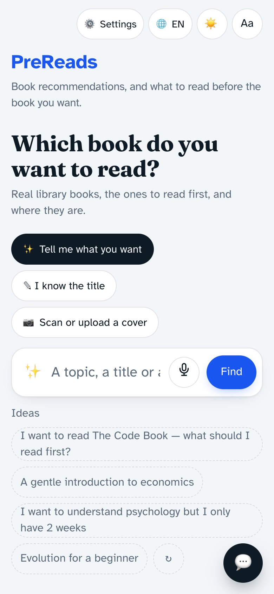
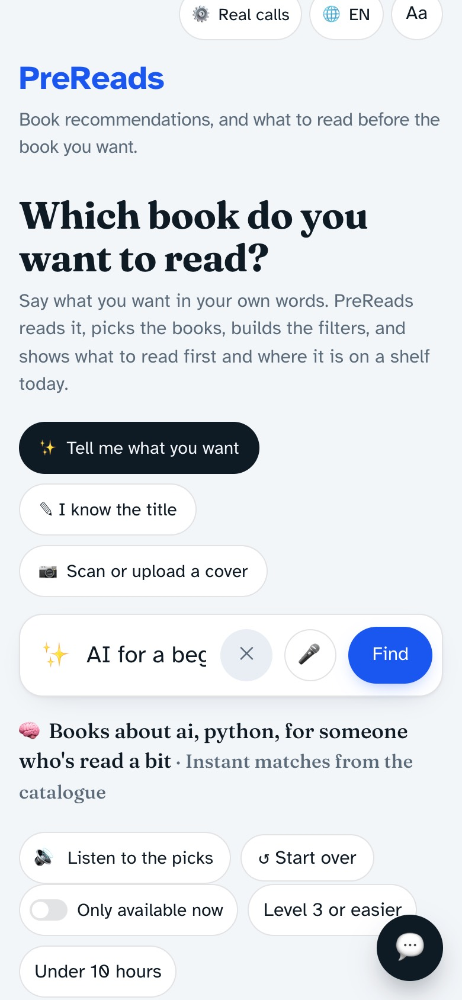
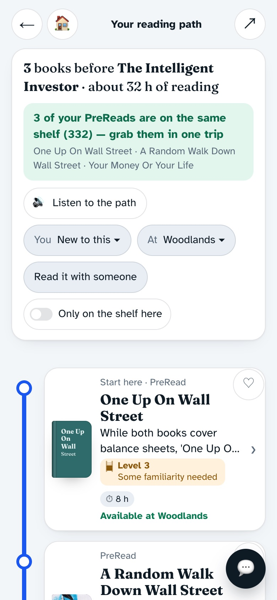
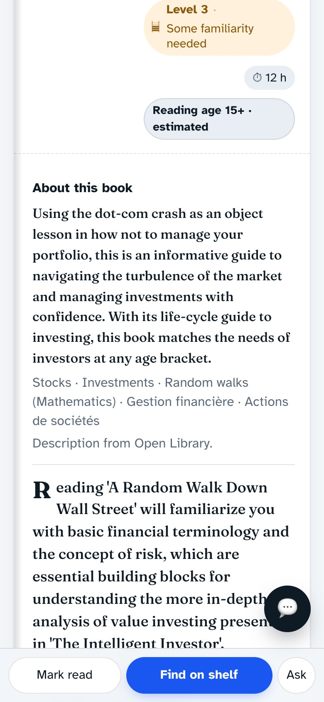
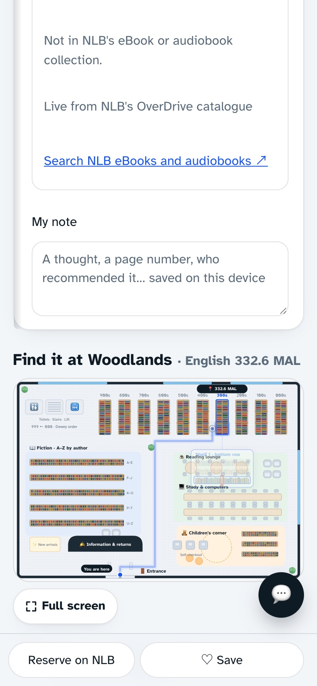
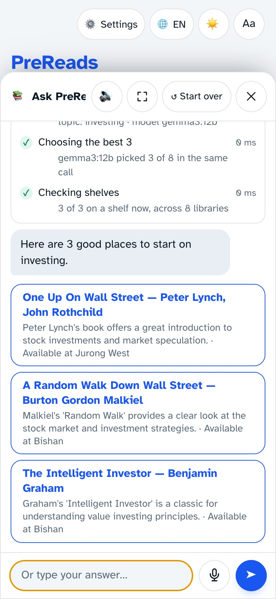

# PreReads

**Search, plan and manage your library reading from a few words.**

Readers spend more time finding books than reading them: searching catalogues, guessing what to read first, then hunting for the right rack. Describe what you want and PreReads finds real library books, builds *your reading path* (easier books first, then your book, then what to read next), keeps your shelf, notes and progress, and shows where each book is at your library today.

- **Demo video:** https://youtu.be/q-sLmH-rzR0
- **Live demo:** https://prereads.vitbhatti.com
- **No-server prototype:** [`docs/index.html`](docs/index.html) (embedded data, works offline)
- **Design:** [Figma screens and clickable prototype](https://www.figma.com/design/c5wM6zZUx2NT91NIEYwbFZ) · [architecture diagrams](https://www.figma.com/board/5TEfAaBhbQFeLO91qIPSuP)

Built by Rahul Mahadik for the Common Ground makeathon (Singapore, October 2026) with open-source AI models (via Ollama) and open library data.

| | | |
|:---:|:---:|:---:|
| <br>Search in a few words | <br>Real books, ranked by AI | <br>Your reading path |
| <br>About the book and where it is | <br>Walk to the shelf | <br>Chat that shows its steps |

## What it does
- **Find books** by describing what you want, typing a title, scanning a cover, or speaking.
- **Your reading path**: PreReads → your book → NextReads, each with a reading level, hours and a reason. Rules are enforced in code: before-books must be easier, confidence ≥ 0.6, at most 3 before and 3 after, one author per before-path, and no book appears twice.
- **At the library**: shelf status per branch, the same-shelf trip ("3 of your PreReads are on the same shelf (332)"), an animated walk to the bay and row, the nearest library with opening hours, reserve or waitlist links.
- **Read or borrow digitally**: live eBook and audiobook copies from NLB's digital collection, publisher samples, and the first chapter in-app for public-domain books.
- **Manage your reading**: My shelf, notes per book, PreReads marked as read and hours left, Meet at the book (two readers, one target), share by QR, printable A6 shelf-talkers.
- **Ask PreReads**: a chat that streams the steps it really runs (understanding, searching, ranking, checking shelves).
- **For everyone**: English, 中文, Bahasa Melayu and தமிழ், light, dark and reading themes, larger text, voice in and out, works offline once opened.

## Tech stack
| Layer | Technology |
|---|---|
| Frontend | React 18 + TypeScript, Vite, hand-written CSS tokens (no UI library), service worker (PWA), vitest |
| Animation | CSS keyframes and SVG path drawing (reading path, walk to the shelf), honouring `prefers-reduced-motion` |
| Backend | Python 3.11+, FastAPI, Pydantic v2, httpx, pytest |
| AI (open-source models via Ollama) | gpt-oss:20b (discovery, reading levels, path judgments), gemma3:12b (chat, and fallback for any missing model), gpt-oss:120b (optional heavy model for precompute and eval), qwen2.5vl:7b (cover scan), nomic-embed-text (semantic search); optional OpenAI via `AI_PROVIDER=openai` |
| Speech | faster-whisper large-v3-turbo (speech to text), Kokoro (voice); browser speech as fallback |
| Data | Open Library, NLB open data and library locations (data.gov.sg), NLB's OverDrive catalogue, Project Gutenberg (Gutendex), NLB Catalogue v2 when keyed |
| Ops | Make, `scripts/setup.py`, Cloudflare Tunnel (`scripts/tunnel.sh`) |

```
backend/app/
  api/           HTTP routers (paths, discover, chat, media, library, system)
  core/          configuration and domain models
  ai/            model provider, embeddings, speech-to-text, voice
  integrations/  NLB/Open Library catalogue, NLB open data, OverDrive, Gutenberg, availability
  services/      reading-path engine, discovery, chat, answers, reading age
frontend/src/    screens (Home, Line, Book, Meet), components, i18n, wayfinding
```
More in [`backend/app/README.md`](backend/app/README.md).

## Quick start
```bash
make setup          # Python venv + npm install (copies .env.example to .env)
make serve          # build the UI and serve everything on http://localhost:8000
```
AI models (optional): install [Ollama](https://ollama.com), then pull each model:
```bash
for m in gpt-oss:20b gemma3:12b qwen2.5vl:7b nomic-embed-text; do ollama pull "$m"; done
```
Voice (optional): `backend/.venv/bin/pip install -r backend/requirements-optional.txt`. Without these the app still runs on cached reading paths and built-in rules.

Useful: `python3 scripts/setup.py doctor` (checks everything), `make test` (backend + frontend tests), `make eval` (audits every cached path), `make warmup` (primes caches), `bash scripts/tunnel.sh quick` (share a public link).

## Data sources
**Data provided by the National Library Board, Singapore (NLB)** ([NLB Labs](https://www.nlb.gov.sg/main/partner-us/contribute-and-create-with-us/NLBLabs)). The NLB datasets and APIs PreReads uses:

- [Libraries](https://data.gov.sg/datasets/d_27b8dae65d9ca1539e14d09578b17cbf/view) (data.gov.sg, `d_27b8dae65d9ca1539e14d09578b17cbf`): library names and locations.
- [National Library Board Library Reach Index, Collections And Loans, Annual](https://data.gov.sg/datasets/d_bf36da418f88e5485aff69079694ecef/view) (data.gov.sg, `d_bf36da418f88e5485aff69079694ecef`): yearly loan totals, refreshed daily.
- [NLB library pages](https://www.nlb.gov.sg/main/visit-us/our-libraries-and-locations): opening hours.
- [NLB's eBook catalogue](https://nlb.overdrive.com) (OverDrive/Libby): live eBook and audiobook copies.
- NLB Catalogue API v2 ([NLB Labs](https://www.nlb.gov.sg/main/partner-us/contribute-and-create-with-us/NLBLabs)): per-branch copies, call numbers and queues when `NLB_API_KEY` and `NLB_APP_CODE` are set; otherwise a built-in table. Pick the source with `DATA_SOURCE=auto|demo|dataset|api` in `.env` or in Settings.

Also: catalogue checks, descriptions and Dewey classes from Open Library; public-domain texts from Project Gutenberg.

Full guide (setup, modes, API, adding titles, troubleshooting): [`docs/GUIDE.md`](docs/GUIDE.md).

## Credits
Data provided by the National Library Board, Singapore (NLB), via data.gov.sg (Singapore Open Data Licence), NLB's library pages and NLB's public OverDrive catalogue; Open Library (CC0), Project Gutenberg, Ollama and the open models above, faster-whisper, Kokoro, and Google Fonts (Atkinson Hyperlegible, Fraunces, Noto Sans SC, Noto Sans Tamil; SIL OFL).

## License
[MIT](LICENSE)
