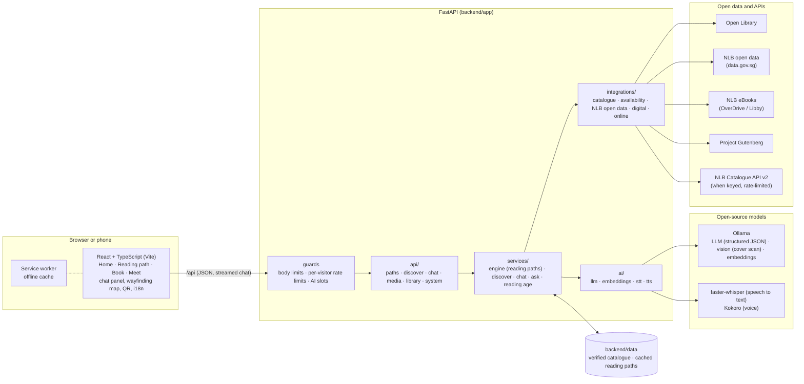
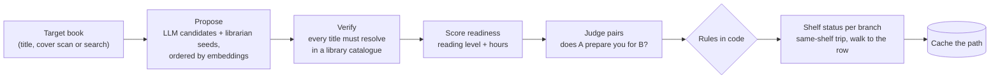
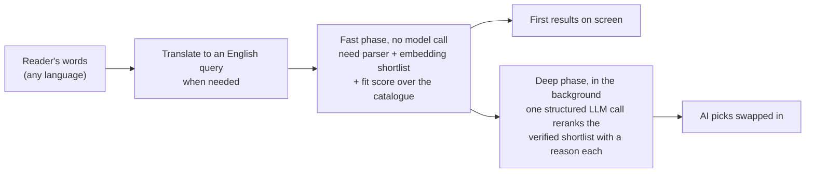

# PreReads architecture

The short version is in the [README](../README.md#architecture). This page shows how the parts fit together,
how a reading path and a search are built, and where the rules live. Package-level detail (what each module
owns and may import) is in [`backend/app/README.md`](../backend/app/README.md).

Design files: [Figma screens and clickable prototype](https://www.figma.com/design/c5wM6zZUx2NT91NIEYwbFZ)
(desktop and phone) and the [architecture board](https://www.figma.com/board/5TEfAaBhbQFeLO91qIPSuP).

## System

The backend also serves the built UI (`frontend/dist`), so one process on port 8000 runs everything.

## How a reading path is built (`GET /api/route`)

The model proposes and judges; the rules are code, not prompt text, so a confident-sounding model cannot
break them:

- books before the target must be easier than it;
- a judgment below confidence 0.6 is dropped;
- at most 3 books before and 3 after, keeping the easiest on-ramp;
- one author per before-path, and no book appears twice;
- a title that does not resolve in a catalogue never reaches the UI.

Without a model the same pipeline runs on heuristics (seed levels, keywords and page counts), so the app
still works on cached paths and built-in rules.

## How a search is answered (`POST /api/discover`)

The deep phase only reorders books that are already catalogue-verified, so it cannot invent a title. New
titles are proposed only when fewer than 3 shortlisted books fit, and each one is verified before it is shown.

## Chat (`POST /api/chat/stream`)

The chat streams the steps it really runs (understanding, searching, ranking, checking shelves) and keeps a
small state: the topic, the books it has shown and the last few turns. Follow-ups such as "the second one" or
"anything shorter?" are resolved in code against that state before any model call.

## Shelf data

`DATA_SOURCE` picks where shelf status comes from:

| Value | Source |
|---|---|
| `api` | NLB Catalogue API v2: per-branch copies, call numbers and queues (needs `NLB_API_KEY` + `NLB_APP_CODE`; falls back to `dataset` without them) |
| `dataset` | NLB open data on data.gov.sg where it exists (libraries, opening hours, yearly loans) and the built-in table for per-branch copies, which no open dataset has |
| `auto` (default) | `api` when both NLB keys are set, else `dataset` |
| `demo` | the built-in table only |

The NLB client respects the published rate limit (1 request per second, 15 per minute), caches responses and
backs off on HTTP 429.

## Safety and load

- Request bodies are capped (JSON, cover scans and audio each have their own limit) and uploaded images are
  checked by content, not by file name.
- Each visitor is rate-limited per route; the machine itself is never limited.
- AI work goes through a small number of slots, so a burst of visitors queues instead of starving the server;
  expensive results are cached with one computation per key.
- Static files are served only from inside `frontend/dist`.

## Frontend

React 18 + TypeScript with hand-written CSS tokens (no UI library). Screens are hash-routed: Home, Reading path,
Book and Meet at the book. Animations are CSS keyframes and SVG path drawing and honour
`prefers-reduced-motion`. A service worker caches the app and recent paths, so it opens offline. Text is in
English, 中文, Bahasa Melayu and தமிழ்.
